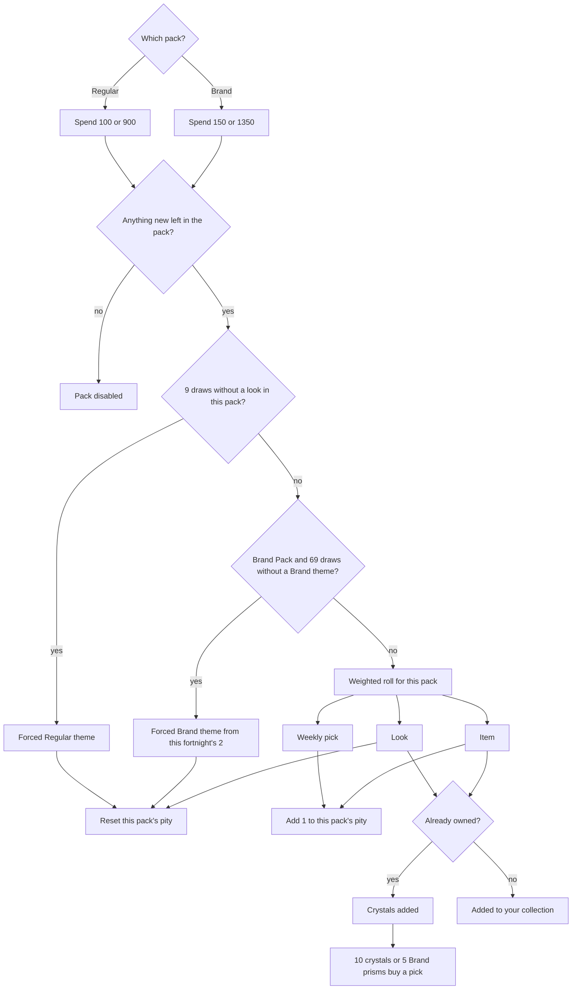

> **Status (2026-11-18):** this is the original gacha design and its numbers are older. The live rules are in `PLAN.md` (Gacha) and the Wiki shows the live odds. The app now says Income for the currency and uses the 5-star rainbow, not gold, for the top tier; the gold Brand prism described below is superseded.

# Gacha drop redesign (Draw Theme)

Replace placeholder coupons with two separate draws, the **Regular Pack** and the **Brand Pack**, each with its own price, odds and pity. Every draw gives something useful, the odds are published in the UI, and each outcome has its own reveal in the capsule machine.

## Current problem

[`gachaEngine.ts`](app/src/state/gachaEngine.ts) is a two-outcome roll: **25% look / 75% coupon**. Coupons only increment a counter with no redeem shop. Specs already call them a placeholder. Expected cost of a random look (~400 Credits) is worse than buying a chosen look (120), and most pulls feel empty.

## Design choices (locked)

- **Two separate packs.** A tab at the top of the Draw Theme pop-up switches between them. Each pack has its own price, drop table, pity counter and machine colour (accent for Regular, gold for Brand).
- **The Brand Pack contains everything in the Regular Pack, plus Brand looks at a low chance.** It is the premium draw, not a different kind of prize.
- **Outcome model:** multi-reward tables, no coupons and **no Credit refunds**. Outcomes are a locked look, a weekly unlock pick, or an **app item** (a useful thing we design and use in the app, see the item catalog below). Earned Credits stay the currency you pay with, never a prize.
- **Economy:** drawing stays *spice*. Buying a chosen look (120) is still cheaper than drawing, but **every draw awards something useful**. Items cannot be turned back into Credits, so draws can never grow your balance. The earlier return numbers (about 58 per 100 and 82 per 150) counted Credit refunds and no longer apply. The item odds below are placeholders until the catalog is chosen, then the value of each item is checked so a draw is still clearly worth less than buying a look.
- **Credits are never sold.** Packs are draws you pay for with earned Credits. The modal says so.
- **"Brand Pack" does not open the brand-colour editor.** That stays with Patreon Silver and above and the creator code. A Brand look is an ordinary look from the Brand set.
- **Repeats turn into crystals, and there are two kinds.** Drawing something you already own is not wasted. A repeat in the Regular Pack gives Regular crystals (only good for a Regular theme of your choice), and a repeat in the Brand Pack gives **Brand prisms**, a different currency (5 of them let you pick one of this fortnight's 2 Brand themes). Crystals can never become Credits. See Crystals.
- **A pack is disabled only when nothing new is left in it.** See below.
- **Content comes from a CMS, not from the EXE.** A stand-alone CMS program manages themes, wallpapers, sounds, boot animations, items, the gacha tables and banners. The app downloads a signed content release at start-up and shows what changed. See Content updates and the CMS.
- **Gacha banners are designed in the same CMS** to announce new things to pull. They are display only and never change odds. See Banners.
- **Looks that are not available yet are hidden, and past ones are shown.** Special Brand colour looks stay hidden until announced. A look that has left the gacha moves to a Past themes showcase so people can see what they missed. See Availability, hidden looks and Past themes.

## Item catalog (to be chosen)

Items replace Credit refunds. Each one must do something real in the app, not just sit in a list. Two kinds: **stackable** (a count you spend, so duplicates are fine) and **one-time** (owned forever; winning one you already own turns into crystals).

| Item | Kind | What it does in the app | Needs art? | Suggested list |
| --- | --- | --- | --- | --- |
| Streak freeze | stackable | Counts as a check-in on a missed day, protecting the weekly quest | yes, item icon | common |
| Layout slot | one-time | One more saved dashboard layout | no | better |
| Font unlock | one-time | Adds a font to the theme editor's font list | font file only | common |
| Wallpaper (20 to 30 to design) | one-time, each | Each wallpaper is its own unlock, usable as the dashboard background | yes, 20 to 30 wallpapers | better |
| Boot screen style (10 to 15 to design) | one-time, each | Each style is its own unlock, usable as the start-up screen. **Rarer than wallpapers.** | yes, 10 to 15 boot animations | better |
| Alert sound (about 20 to design) | one-time, each | Each sound is its own unlock, chosen as the tone for station alerts | yes, audio (about 20 sounds) | common |
| Name flair | one-time | A colour or small mark on your name in the top bar | no | common |
| Custom upload unlock | one-time | Lets you upload your own custom file. What it covers (wallpaper, theme or boot image) is not decided yet. **Brand Pack only** | no | Brand Pack only |

**Inside the Better item row.** When a draw lands on Better item, a second roll picks the kind, then a random one of that kind (one you own turns into crystals). Boot screens are deliberately rarer than wallpapers. These weights are a proposal:

| Kind inside Better item | Regular Pack | Brand Pack | Chance per draw (Regular / Brand) |
| --- | --- | --- | --- |
| Wallpaper | 70% | 55% | 17.5% / 13.75% |
| Boot screen style | 20% | 30% | 5% / 7.5% |
| Layout slot | 10% | 15% | 2.5% / 3.75% |

The Brand Pack leans towards boot screens, which is how it gets the better prizes the plan promised, while a boot screen stays rarer than a wallpaper in both packs.

**Inside the Common item row.** Same idea: a second roll picks the kind, then a random one of that kind (one you own turns into crystals). These weights are a proposal. Alert sounds share one kind so 20 of them do not crowd out the others.

| Kind inside Common item | Weight | Chance per draw (Regular / Brand) |
| --- | --- | --- |
| Streak freeze (stackable) | 30% | 17.1% / 17.1% |
| Alert sound (about 20, shared) | 50% | 28.5% / 28.5% |
| Font unlock | 10% | 5.7% / 5.7% |
| Name flair | 10% | 5.7% / 5.7% |

Counts used for the per-item chances: 25 wallpapers, 12 boot screens, 20 alert sounds (midpoints of what is being designed). Owned items stay in the pool (a repeat becomes crystals), so these per-item chances do not change as you collect.

Rules for any item:
- No item may open the brand-colour editor or any Patreon benefit.
- No item may add Credits.
- A stackable item can be earned many times and never repeats. A one-time item you already own turns into crystals.
- No item may give a draw or a free pull, so a draw can never pay for the next one.

## Pools

- **Regular pool:** every locked look that is not in the Brand set, plus any Brand looks the CMS adds back (`regularExtraIds`, Themes → Back in Regular Pack).
- **Brand set:** the 28 looks tagged `group: "Brand"` in [`themeCatalog.ts`](app/src/state/themeCatalog.ts) (Spotify Night through Airbnb Coral). Check which of them are locked when building; only locked ones can be won (a Brand theme you own turns into crystals). **Brand themes start Hidden** and only appear once the CMS makes them Available (see Availability).
- **This fortnight's Brand themes:** only **2 of the 28** can be drawn at a time (see Brand rotation).
- **Brand Pack pool:** this fortnight's 2 Brand themes plus the Regular pool.

## Drop tables

The numbers below come from `GACHA ODDS v3.xlsx`.

Each draw rolls one weighted outcome. Rolls are independent; owned looks and items stay in the pool and a repeat becomes crystals.

**Regular Pack: 100 Credits, or 900 for ten**

| Outcome | Chance | What the player gets |
| --- | --- | --- |
| Regular theme | **15% chance** | Random look from the Regular pool (a repeat turns into crystals) |
| Weekly unlock pick | **3% chance** | `+1` to `looksWaiting` (the token Themes already redeem for any locked look) |
| Better item | **25% chance** | One item from the better list (catalog below) |
| Common item | **57% chance** | One item from the common list |

**Brand Pack: 150 Credits, or 1,350 for ten** (price is a proposal; change it freely)

| Outcome | Chance | What the player gets |
| --- | --- | --- |
| Regular theme | **13.5% chance** | Random look from the Regular pool, the same pool as the Regular Pack (a repeat turns into crystals) |
| Brand theme | **1% chance** | One of this fortnight's 2 Brand themes, about **0.5% each** (the rare row; a repeat turns into crystals) |
| Weekly unlock pick | **3% chance** | `+1` to `looksWaiting` |
| Custom upload unlock | **0.5% chance** | The Custom upload unlock item (Brand Pack only; a repeat gives 5 Brand prisms) |
| Better item | **25% chance** | One item from the better list, with boot screens more likely than in the Regular Pack (see the weights above) |
| Common item | **57% chance** | One item from the common list |

The Brand Pack lists **Regular theme** and **Brand theme** as two separate rows, each with its own chance, so the Brand theme chance can be changed on its own without touching the rest (keep the six rows adding up to 100%).

**Weekly pick: at most 2 per week.** Draws can give at most **2** weekly unlock picks in a week, counted across both packs. After the second win, the Weekly pick row is removed for the rest of that week. The weeks are the same Monday-to-Sunday weeks the quests already use (`weekKey` in [`questEngine.ts`](app/src/state/questEngine.ts)), so it comes back on Monday. While the row is off, its chance moves to Streak freeze (the stackable item that never runs out), so each pack still adds up to 100%. A ten-draw can drop one or two, but never more than the 2 left for the week. This also keeps draws from cheapening the 5-day check-in quest, because at most two extra picks can arrive per week. The limit of 2 is a single constant to change.

**Repeats and the disabled state.**
- No row is ever removed. A repeat of a one-time item or a look becomes crystals.
- A pack is disabled only when every look and one-time item in it is already owned. It says "You already have everything in this pack." Patreon Basic and the creator code open every look but not the items, so their packs keep working.

**Look pity (separate counter per pack).** After **9** draws in a pack without any look, the next draw in that pack **forces a Regular theme you do not own** (a repeat, giving crystals, only if none are left). Reset that pack's counter on every look. A look is therefore guaranteed within 10 draws in each pack. A Brand theme never comes from this rule.

**Brand pity (Brand Pack only): a Brand theme within 70 draws.** The Brand Pack keeps a second counter of draws since the last Brand theme. After **69** draws without one, the 70th draw **is a Brand theme** (one of this fortnight's unowned two). 70 is a middle value for your 60 to 80 range and is a single constant to change. Reset on every Brand theme, and only on a Brand theme: a rainbow Regular theme won in the Brand Pack does not reset it (round 5, design D1; the Region Pack's pity works the same way toward its featured looks). The counter carries across a fortnight change, and holds its value (no counting) while both featured themes are owned. At 150 Credits a draw the worst case is about 10,500 Credits, so check how fast Credits are earned before settling the number.

**Brand rotation: 2 Brand themes every 2 weeks.** The Brand Pack can only give 2 of the 28 Brand themes at a time, and the two change every 14 days. 28 themes at 2 a fortnight is exactly 14 fortnights per full cycle.
- By default the two are worked out from the date, not stored, so they are the same on every PC and need no server. Each period number (days since a fixed start date, divided by 14) picks 2 themes from a shuffle that is seeded by the period. **The CMS can publish an explicit schedule that overrides this.** The date rule is the fallback when no schedule is published and when the PC is offline.
- The shuffle goes through all 28 themes before any theme returns, so every Brand theme turns up over time.
- A Brand theme you already own turns into crystals if you draw it again. The forced Brand theme from pity is one you do not own while either remains.
- The Brand tab shows the two themes with their colours and "changes in N days", so the odds are honest and people know what they are drawing for.
- It uses the PC's clock. Setting the clock forward would show a later rotation, which costs nothing because it only changes which two are drawable.

**Ten-draw guarantee (both packs).** Every 10-draw purchase contains **at least one Regular theme**. If the ten rolls produce none, one roll (the last) is replaced with a Regular theme. This is why the Regular theme chance can stay low. In the Brand Pack a Brand theme does not count towards it. The guaranteed theme is one you do not own while any remain, otherwise a repeat that gives crystals.

**Batch rules:** every roll in a ten-draw is independent, so a repeat inside one purchase is possible and gives crystals. Pity carries through the batch.

**Chosen look still costs 120** (the default; it is a CMS setting like the pack prices).

## Card Pack (dashboard card skins)

A fourth pack in the Draw tab. Its prizes are **card skins**: a skin restyles every card on the dashboard (surface, frame, edge light) on top of whichever theme is active, so it reads on every theme. Players put one on from **Themes → Card skins**. Skin art is CSS in the app (`app/src/styles/cardskins.css`), so a new skin needs an app update; the CMS **Cards** tab switches skins on and off, sets their stars and runs the pack.

**Price and ticket:** 120 Credits, or 1,080 for ten. Takes a **Special Ticket** (the CMS can change it).

| Row | Chance per draw | What the player gets |
| --- | --- | --- |
| 5-star card skin | 1% | One of the Available 5-star skins (moving light) |
| 4-star card skin | 10% | One of the Available 4-star skins (still surfaces) |
| Better item | 25% | Same mix as the Regular Pack (wallpaper 70%, boot 20%, layout slot 10%) |
| Common item | 64% | Same mix as the Regular Pack (streak freeze 30%, alert sound 50%, font 10%, flair 10%) |

**Pity:**
- **4-star or better at least every 10 draws.** The 10th draw without a skin keeps its normal (soft-pity) 5-star chance; otherwise it is a 4-star skin (one you do not own when one is left). This also makes every ten-draw hold at least one skin.
- **5-star guaranteed by draw 70** since the last 5-star skin. **Soft pity** from draw 60: the 5-star chance climbs evenly from 1% to 100% at draw 70. A 5-star resets both counters; a 4-star resets only the 4-star counter.
- Simulated over 3 million draws: one 5-star skin every 46.8 draws on average (about 5,600 Credits at 120 a draw, about 5,050 buying ten at a time); most land in the soft-pity stretch from draw 60 to 69. A 4-star turns up about every 7 draws (6.9), and any skin about every 6, never more than 10 apart. Effective shares: 5-star 2.1%, 4-star 14.5%, Better item 23.5%, Common item 59.9%.
- A tier with no Available skin has no row and no guarantee; its share is spread over the other rows in proportion.

**Repeats:** a skin you already own pays **Regular crystals**: 2 for a 4-star, 5 for a 5-star. No skin is ever sold for Credits and no skin gives Credits back.

**Skins (bundled, all Available):**

| Stars | Skins |
| --- | --- |
| 5-star (6, animated) | Holo Foil, Aurora Drift, Solar Flare, Prism Glass, Molten Core, Starfield |
| 4-star (12, still) | Carbon Weave, Brushed Steel, Blueprint, Velvet Night, Circuit Trace, Frosted Glass, Scanline, Gilded Edge, Topo Lines, Hex Mesh, Paper Grain, Neon Rim |

5-star skins stop moving under Reduce motion and the system reduced-motion setting. Each Available 5-star skin has a 1/6 share of the 1% row (about 0.17% per draw); each Available 4-star skin a 1/12 share of the 10% row (about 0.83%).

**Release fields:** `gacha.cardPack` (`enabled`, `ticket`, `priceOne`, `priceTen`, `weights` as fractions, `fourPityAfter: 9`, `fivePityAfter: 69`, `softPity`, `crystalValues`, `skins` with `id`, `stars`, `status`). A release without it uses the bundled pack; unknown skin ids are ignored by the app.

## Daily check-in event

Every check-in box pays **Special Tickets** (1, 1, 2, 1, 1, 1, 3 over the seven days). Regular Tickets earned before stay spendable. The CMS can run the board as an event with a **start and an end** (Calendar → Daily check-in event; release field `gacha.checkinEvent`, local date-times `YYYY-MM-DDTHH:mm`, end exclusive). Outside the window the boxes are hidden and the board says when the next event starts; held tickets still work on Draw. No window means the board is always on.

## Crystals (two kinds)

**Repeats become crystals, by pack.** When a draw gives a look or one-time item you already own, it turns into crystals of the pack you drew in. Weekly picks and streak freezes stack, so they never repeat. Crystals are not Credits and can never be turned into Credits. Values per repeat (a proposal, the same in both packs):

| What repeated | Crystals |
| --- | --- |
| Common item (font, name flair, alert sound) | 1 |
| Better item (wallpaper, boot screen, layout slot) | 2 |
| Regular theme | 3 |
| Brand theme | 5 |
| Custom upload unlock (Brand Pack only) | 5 |

| | Regular crystals | Brand prisms |
| --- | --- | --- |
| Earned from | repeats in the Regular Pack | repeats in the Brand Pack |
| Look | blue faceted crystal | gold prism with a spectrum edge |
| Spent on | **only** a Regular theme of your choice | **only** a pick of one of this fortnight's 2 Brand themes |
| Cost | 10 crystals = 1 pick | **5 prisms = 1 pick** |

- **Brand prisms are their own currency, not a kind of crystal.** They have a different name, a gold prism icon in place of the blue crystal, their own counter and their own colour. Repeat cards read "+N crystals" in the Regular Pack and "+N Brand prisms" in the Brand Pack. The Crystals tab shows them under two separate headings, and the two can never be swapped or combined. Where this plan says just "crystals" for the currency of a pack, it means that pack's own: crystals in the Regular Pack, prisms in the Brand Pack.
- **Regular pick:** choose any Regular look you do not own and it unlocks. Nothing else can be bought with Regular crystals.
- **Brand pick:** choose one of this fortnight's 2 Brand themes you do not own and it unlocks. If you own both, the prisms wait for the next rotation. Prisms and crystals are both kept across rotations.
- This replaces the earlier Box and its free draw. There is no free draw anywhere, so a draw can never pay for the next one.

**Balance warning (needs your decision).** A chosen Regular look costs 120 Credits to buy directly, so 10 Regular crystals (about 8 late-game draws, around 800 Credits of drawing) is a poor deal against buying. It is a consolation for repeats, not a route to look at. The Brand pick is the opposite: late in the game 5 Brand prisms take about 4 draws (around 600 Credits), far cheaper than the 70-draw Brand pity (up to 10,500 Credits) or the 1% chance. Brand themes come out two at a time per fortnight, which caps it, but the crystals could become the main way to get them. If that is too generous, raise the cost (for example 8 crystals) or lower the crystal values.

## Content updates and the CMS

The game's content (themes, sounds, boot animations, wallpapers, items, the gacha tables and banners) stops being fixed inside the EXE. A separate **stand-alone CMS program** edits it and publishes a release. The app downloads the release at start-up and shows what changed.

### The parts

| Part | What it is |
| --- | --- |
| CMS program | A stand-alone admin program, separate from the app. Only the owner uses it. |
| Content release | A numbered manifest (JSON) plus asset files, each with a hash, published to a host the app can reach. |
| Signature | The CMS signs every manifest with a private key. The app holds the matching public key and rejects anything unsigned or changed. |
| The app (EXE) | Ships with bundled default content so it works offline on day one, checks for a newer release at start-up, downloads what changed and applies it. |
| Local service | Stores the downloaded content in the app data folder and serves it to the screens. |

### What the CMS manages

- **Themes:** palette, name, group (Regular or Brand), status (Hidden, Available, Archived) and dates.
- **Files and their items:** wallpapers, alert sounds, boot animations, fonts and name flairs, with the item entries that point at them.
- **Credits spending:** every price paid in Credits is a CMS setting, not a fixed number in the app: the Regular Pack and Brand Pack prices (one draw and ten draws), the cost of unlocking a chosen look (120 today), and the Credit cost of any other unlock such as Nightsteel. Earning Credits (quest rewards) is not included unless you ask for it.
- **Chances and rules:** the drop tables and every weight (row chances, the weights inside Better item and Common item, the Brand theme and Custom upload unlock chances), pity numbers, the ten-draw guarantee, the weekly pick cap, crystal and prism values and costs, and the Brand rotation schedule.
- **Banners** (next section).
- **Release notes** shown in the app as What's new.

### Start-up update flow

1. At start-up the app asks for the current release number (a small request).
2. If a newer release exists, it downloads only the files whose hash changed. Progress shows as a step on the boot screen ("Updating content"). It verifies the signature and hashes, then applies everything at once, so a half-finished update never shows.
3. After the app loads, a **What's new** panel lists the new themes, items and banners, any odds change, and the release notes.
4. If the PC is offline or a download fails, the app keeps its current content, carries on, and tries again at the next start.
5. Large media (full-size wallpapers, long animations) download in the background after start-up with a progress bar. Thumbnails and small files come first so nothing blocks the app. Whether to block start-up instead is an open question.

### Rules

- **Data and files only, never code.** A new theme, wallpaper, sound or boot animation of a type the app already supports needs only a release. A new kind of item (new behaviour) or a new animation format needs an app update. The CMS marks such content with a minimum app version, and older apps skip it.
- **Owned things are never removed.** Anything a user owns stays usable after it is archived or hidden.
- **The app never trusts a release blindly.** It checks that each drop table totals 100%, prices are positive, every referenced item exists and every file matches its hash. An invalid release is rejected and the previous one stays.
- **Price and chance changes are guarded.** The CMS only accepts a price inside a set range and chances that total 100%, and it runs the economy check before publishing (the average value returned per draw must stay under the price). A new price or chance applies only to spending done after the update. Nothing already spent or won is changed afterwards, and Credits a player holds are never touched.
- **Odds changes are visible.** The draw screen always shows the current published odds, and What's new lists any change.
- **Versioned and reversible.** Every release has a number. The CMS rolls back by publishing the previous release as a newer one.

### CMS program features

- Create and edit content; draft, preview in a mock of the app, publish, schedule and roll back.
- Upload assets with size and format checks.
- Checks before publishing: odds total 100%, an economy check that the average value returned per draw stays under the price (the same formulas as `GACHA ODDS v3.xlsx`), and every featured item has art.
- An audit log of who published what and when.
- Hosting and login are open questions.

## Banners

A banner is a designed card, made in the CMS, that announces new things to pull in the gacha. It is **display only** and never changes odds.

- **Fields:** title, subtitle, banner art (image), the pack it belongs to, the featured items (themes, wallpapers, sounds, boot screens), start and end dates, priority and a short line of text.
- **Where it shows:** a strip at the top of the Draw Theme pop-up, one banner at a time with dots to switch when there are several. No autoplay when reduced motion is on.
- **A "New" mark** on the Draw Theme button until the banner has been opened.
- **Featured items open a preview** when tapped.
- **Honest wording:** every banner says "Same odds as the pack. Featured items are the ones available now." A banner never promises better odds.
- Banners appear and disappear by their dates and are also listed in What's new.

## Availability, hidden looks and Past themes

Every theme in the content has a status that the CMS controls:

| Status | In the Themes page | In the gacha | What the user sees |
| --- | --- | --- | --- |
| Hidden | not shown | no | Nothing. It does not exist for them yet. |
| Available | shown in the Locked section | yes | Normal. |
| Archived | shown only in **Past themes** | no | "Not available now. It may come back." |

- **Special Brand colour looks start Hidden.** They are not in the Locked list and cannot be found until the CMS announces them and sets them Available, which is also when they can join the featured rotation.
- **Brand themes are only won in the Brand Pack** (a draw, pity or Brand prisms). They are not bought with Credits and not opened with a weekly pick. This is a decision to confirm. Regular locked looks work as they do now.
- **Past themes showcase.** A Past themes section on the Themes page shows every Archived theme in colour, with its name and when it was last available, so people can see what they missed. It does not promise a return. If the CMS marks a possible return it can say "may return", and it never gives a date unless one has been announced.
- A theme the user already owns stays in their Unlocked list and can be used even after it is Archived.
- Status changes arrive in a content release, so hiding or revealing a look needs no app update.

## Phases

The CMS work is large, so it comes after the gacha itself, in this order:

1. **Data-driven gacha.** The engine and screens read their tables, items and themes from a content object bundled in the app (a copy of today's numbers). Nothing is downloaded yet. This is the base, and the engine rewrite below already builds towards it.
2. **Statuses, Past themes and the banner strip**, using the bundled content.
3. **Content delivery:** manifest, signature check, start-up download, apply, What's new.
4. **The CMS program** that edits and publishes releases, with a local test server on its own port (see Testing the CMS locally).
5. **Hosting, login and the first real release.**

## Testing the CMS locally

The CMS can be tested on your own PC, before any real hosting exists, with a second local web server running next to the app.

| Piece | Local address (proposed) | What it does |
| --- | --- | --- |
| The app (dev) | `localhost:1420` | The game as it runs today. |
| **The CMS (dev)** | `localhost:1430` | The CMS opened as a web page in the browser. Edit content, then publish. |
| Local release host | served by the CMS dev server, for example `localhost:1430/releases` | Holds the published releases (manifest and files), standing in for real hosting. |

- **One command to start it.** A new entry in `.claude/launch.json` (for example `cms`) starts the CMS dev server on its own port, so the app and the CMS run side by side and one does not block the other.
- **The app points at the local host in dev only.** A dev-only setting (never in a shipped build) tells the app to fetch releases from `localhost:1430/releases` instead of the real host.
- **A test signing key.** The CMS dev server signs releases with a throwaway test key. The dev build of the app trusts that key. The real key and real host are never used in testing.
- **Test data stays separate.** Local releases and CMS data live in their own folder, not in the real content, so testing never touches players.

What to check on the local setup:
1. Publish a release in the CMS and see the app pick it up at the next start, with the boot-screen progress step and the What's new panel.
2. Change a pack price and a chance in the CMS and see the draw screen show the new price and odds.
3. Add a banner and see it in the Draw Theme pop-up, then let it expire by date.
4. Set a theme to Hidden, Available and Archived and check the Themes page and Past themes each time.
5. Publish an invalid release (odds not totalling 100%, a missing file, a bad signature) and check the app rejects it and keeps the old content.
6. Roll back to the previous release.
7. Stop the CMS server and start the app: it should run on its current content without errors.

## Engine changes

Primary file: [`app/src/state/gachaEngine.ts`](app/src/state/gachaEngine.ts)

- Remove `PROVISIONAL_LOOK_CHANCE` and coupon as a `DrawResult`.
- New result union:
  - `{ kind: "look"; id: string; brand: boolean; repeat: boolean }`
  - `{ kind: "pick" }`
  - `{ kind: "item"; id: string; repeat: boolean }`
  - A repeat carries its crystal value and is added to the crystal count of the pack it was drawn in, instead of the collection.
- Export one named table per pack (prices, weights, item lists) as the single source of truth for engine, UI and tests.
- `GachaState`: drop `coupons`; add `lookPity: { regular: number; brand: number }` (the 9-draw rule) and `brandPity: number` (the 70-draw Brand theme rule), and `crystals: number` and `prisms: number`; bump `v` to `2`.
- Add `spendRegularCrystals(id)` (10 crystals, any unowned Regular look) and `spendBrandPrisms(id)` (5 prisms, one of this fortnight's unowned two). Both refuse when short or when the look is not allowed.
- Add `weeklyPicks: { week: string | null; count: number }` to `GachaState`: the `weekKey` of the current week and how many weekly picks draws have given in it (reset to 0 when the week changes). The Weekly pick row is skipped once `count` reaches 2, and its chance goes to Streak freeze.
- Read the packs, odds, item list, prices, pity numbers, caps, crystal and prism values and the rotation schedule from a **content object**. The bundled default content equals this plan. Validate it before use and fall back to the bundled content if it is invalid.
- Add `featuredBrand(now)`: returns this fortnight's 2 Brand themes: from the CMS schedule when one exists, otherwise from the date, deterministic and with no storage.
- Migration in `cleanGacha`: v1 state with `coupons > 0` becomes **15 Credits per coupon**, returned as a one-shot `pendingCredits` the modal applies once before persisting v2 (the engine stays free of storage side effects).
- `drawMany(pack, count, owned, pity, rand)` returns `{ results, pity }`. It takes a pack so each table, pool and pity counter stays separate.
- Add `grantPick` in [`questEngine.ts`](app/src/state/questEngine.ts) / [`useQuests.ts`](app/src/state/useQuests.ts) (`looksWaiting + 1`). Today only `takeLookPick` exists. Cap what can be held (for example 5) so draws do not cheapen the 5-day check-in quest.

## UI changes

[`GachaModal.tsx`](app/src/components/GachaModal.tsx) (`GachaPanel.tsx` is already removed):

- Pack tabs at the top (Regular, Brand). Each shows its price and its own pity line, for example "A new look is guaranteed within 7 draws." The ten-draw button says "10 draws: at least 1 Regular theme". The Brand tab also shows this fortnight's two Brand themes, a "changes in N days" line and "A Brand theme is guaranteed within N draws."
- Result cards for look / Brand look / weekly pick / item. A look reuses the swatch, a Brand look gets a gold edge, and the pick and each item get a drawn icon.
- Apply path: `onWin(id)` for looks, `grantItem(id)` for items, `grantPick()` for picks, then persist pity.
- Replace "drop rates are not set" with the published table for the selected pack, with percentages read from the engine constant.
- A repeat card says "Repeat: +N Regular crystals" or "+N Brand prisms". A Crystals tab shows both counts with a progress bar each (to 10 and to 5), and a Pick button that opens a choose-a-theme dialog: the unowned Regular looks for Regular crystals, this fortnight's two for Brand crystals.
- Disabled state with a clear message when a pack has nothing new left in it.
- Remove the coupon line from the footer ("Coupons held").
- Banner strip at the top of the pop-up, and a "New" mark on the Draw Theme button (see Banners).
- Themes page: hide Hidden themes, add a Past themes section, and show a "What's new" panel after a content update (see Availability and Content updates).

## Capsule machine and reveal

> **Replaced.** The draw is now an ink pad, a pull cord and a rail of badges. See [DRAW ANIMATION PLAN.md](DRAW ANIMATION PLAN.md). The capsule notes below are no longer current.

The machine is built ([`GachaMachine.tsx`](app/src/components/GachaMachine.tsx), [`gacha-machine.css`](app/src/styles/gacha-machine.css)). Remaining work:

- Finish checking the opening: the burst frames at about 2.7s to 2.9s read muddy. Make the two capsule halves clearly visible as they pop, keep the flash short, then cut to the cards.
- Machine colour by pack: accent for Regular, gold for Brand.
- Capsule colour by outcome: the look's own accent for a look, gold for a weekly pick, a tone per item rarity. Longest, brightest reveal for a Brand look, then a look, then a weekly pick or a better item, with a short quiet one for a common item.
- 10-draw: open capsules in quick succession, then show the whole set together.
- Keep Skip from the first frame and the reduced-motion shortcut.
- Check it at the modal's narrow width and in a light theme.

## Docs + tests

- Update the Gacha section in [`PLAN.md`](PLAN.md): the two packs, rates, prices, pity and the disabled state, with no coupon placeholder language.
- Expand [`app/service/test/gacha.test.mjs`](app/service/test/gacha.test.mjs): weights per pack via fixed `rand` sequences, look pity forces a Regular theme at 10 and is counted per pack, Brand pity forces a Brand theme at 70 and carries over a rotation, `featuredBrand` returns 2 themes, is stable within 14 days, changes after it and covers all 28 before repeating, a repeat look or one-time item gives the right crystals and stays out of the collection, stackable items add up and never repeat, forced and guaranteed themes are new while any remain, a ten-draw always holds at least one Regular theme, a pack is disabled only when everything is owned, repeats in each pack give that pack's crystals, Regular crystals cost 10 and only unlock a Regular look, Brand prisms cost 5 and only unlock one of this fortnight's two, a pick is refused when short or for an owned or out-of-rotation look, crystals survive a rotation, migration of old coupon state, pick cap, content validation (a release with odds that do not total 100% or a missing item is rejected and the bundled content is kept), the default content equals this plan, status rules (Hidden never shown or drawn, Archived only in Past themes and never drawn, owned Archived themes stay usable), and the weekly pick limit (at most 2 per week across both packs, row removed after the second win, back on Monday, a ten-draw cannot go over the 2, chance moved to Streak freeze while off).

## To do

1. Choose the item catalog with the owner, and confirm which of the 28 Brand themes are locked (see open questions).
2. Rewrite `gachaEngine`: per-pack tables, pools, look pity, Brand pity, the fortnightly Brand rotation (`featuredBrand`), v2 state, no coupons, items in place of Credits.
   - Add an item store (`items.ts`): owned one-time items, stackable item counts, and the hooks each item uses in the app.
3. Add `grantPick` (+1 `looksWaiting`, capped) in `questEngine` / `useQuests`.
4. Update `GachaModal`: pack tabs, apply path, result cards, published rates, pity line, disabled state, coupon migration.
5. Finish the capsule animation: clear opening burst, machine and capsule colour, 10-draw sequence.
6. Update gacha tests and the `PLAN.md` Gacha section.
7. Build crystals: repeat conversion in the engine, the Crystals tab, the two spend functions and the choose-a-theme dialog.
8. Check in the browser: both packs, single draw, 10-draw, skip, reduced motion, a disabled pack.
9. Make the gacha data-driven (phase 1 above): the content object, the bundled default content and its validation.
10. Add statuses (Hidden, Available, Archived), the Past themes section and the banner strip using bundled content (phase 2).
11. Content delivery: manifest, signature check, start-up download, apply and What's new (phase 3).
12. The CMS program, then hosting, login and the first real release (phases 4 and 5). These are separate projects and need their own plan.

## Open questions

- **Brand Pack price.** 150 / 1,350 is a proposal.
- **Brand themes are locked?** There are 28 Brand themes. Confirm how many are locked, because a free one cannot be won.
- **Brand pity number.** 70 is a proposal inside your 60 to 80 range.
- **Crystal values and costs.** The values (1, 2, 3, 5) and the costs (10 Regular, 5 Brand) are proposals. See the balance warning under Crystals.
- **Is the Box gone?** The earlier mixed Box and its free draw were dropped to match two crystal kinds with fixed uses. Say if a Box should come back for Regular crystals.
- **Which items go in the catalog,** and which are common and which are better.
- **Regular theme chance.** 15% in the Regular Pack and 13.5% in the Brand Pack; the ten-draw guarantee still covers the rest. Single draws still rely on the 9-draw pity.
- **CMS price limits.** What range should the CMS allow for each Credits price (for example a draw between 50 and 500)? And should quest rewards (earning Credits) also be a CMS setting?
- **Where do releases live and who can log in to the CMS?** Hosting and CMS login are not decided.
- **Block start-up or download in the background?** The plan downloads small files first and large media in the background. Your wording was that the user must download at start-up. Say if everything should block instead, and what size limit is acceptable.
- **Brand themes only from the Brand Pack?** The plan says they cannot be bought with Credits or a weekly pick. Confirm.
- **Which of the 92 locked looks stay Available and which start Hidden?** The plan hides the 28 Brand colour looks first.
- **Boot animation format.** Boot screens are code today, so downloadable ones need a defined data format. This needs a decision before phase 3.
- **Custom upload unlock.** What it unlocks (own wallpaper, theme or boot image) is not decided. It is Brand Pack only at 0.5% per draw, and it is one-time (a repeat gives 5 Brand prisms).
- **Spreadsheet fix.** In `GACHA ODDS v3.xlsx` the Common item formula subtracts the Custom upload unlock twice, so the Brand Pack total shows 99.5% and Common shows 56.5%. The plan uses the correct 57%. Fix: Inputs `B11` and `C11` should be `=1-SUM(B6:B10)` and `=1-SUM(C6:C10)`, and `B12`, `C12` should be `=SUM(B6:B11)` and `=SUM(C6:C11)`.
- **Brand Pack odds.** The Brand theme row is 1% in total (about 0.5% each of the 2 featured themes). A separate Brand pity counter guarantees one within 70 draws.

## Out of scope

- Coupon redeem shop
- Rarity tiers and rate-up banners (banners are display only and never change odds)
- Brand editor, ranks, fonts, or Patreon benefits as drops
- Changing the default `LOOK_COST` (120) in this plan. It becomes a CMS setting, and the bundled default stays 120.
- Fake near-miss reveals (a flash that turns out common) and hidden odds
